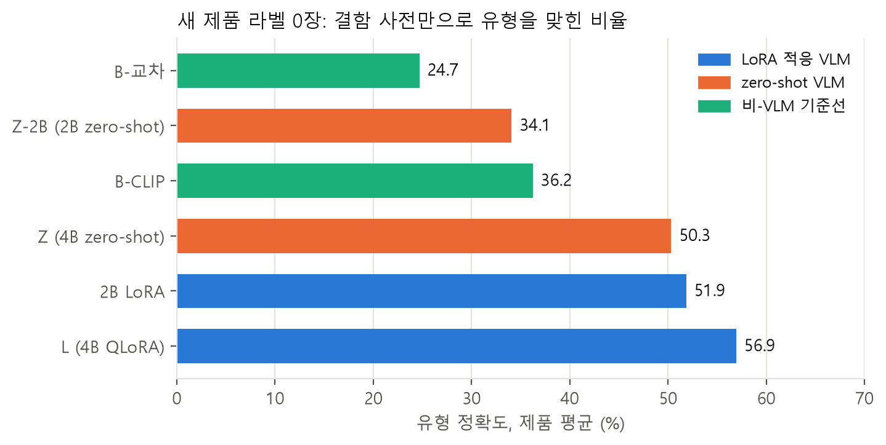
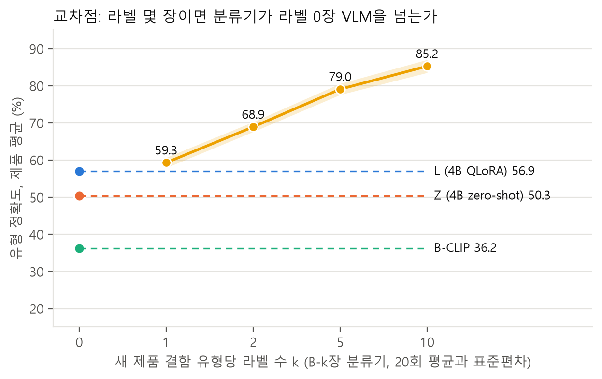

# 결함 정보만 주고 새 제품을 검사하기: LoRA 적응 VLM의 콜드 스타트 실험

처음 보는 제품의 결함 라벨이 한 장도 없을 때, 결함 유형의 이름과 한 줄 정의만 글로 주면 비전 언어 모델(VLM)이 결함 유형을 맞힐 수 있는가. 그리고 전문 few-shot 분류기가 그 성능을 따라잡으려면 새 제품의 라벨이 몇 장 필요한가. MVTec AD 15개 제품을 제품 단위 5-fold로 나누어, 12개 제품으로 QLoRA 적응한 Qwen3-VL이 나머지 3개 제품을 사전만 보고 검사하게 했다. 로컬 GPU 1장(RTX 3060 12GB)에서 학습하고 평가한다.

```
유형: 균열
근거: 캡슐 껍질에 금이 간 선이 보인다
```

## 결과

자세한 결과와 가설 판정은 [`docs/results.md`](docs/results.md)에 있다. 표는 [`reports/tables/summary.md`](reports/tables/summary.md), 실패 사례는 [`reports/tables/failures.md`](reports/tables/failures.md)다.



| 방법 | 새 제품 라벨 | 유형 정확도(제품 평균) | 공통 유형 | 고유 유형 | 정상 판정률 |
|---|---|---|---|---|---|
| B-교차(교차 제품 분류기) | 0 | 24.7 | 54.2 | 0.0 | |
| B-CLIP(SigLIP 텍스트 매칭) | 0 | 36.2 | 37.9 | 28.1 | |
| Z(4B zero-shot, 같은 입력) | 0 | 50.3 | 49.7 | 45.4 | 27.8 |
| L(4B QLoRA) | 0 | 56.9 | 56.2 | 49.6 | 72.6 |
| B-1장 | 유형당 1 | 59.3 | 50.0 | 69.7 | |
| B-전체 | 전부 | 87.6 | 79.0 | 92.0 | |

- 라벨 0장에서 L은 비-VLM 최고치보다 20.7점 높다. 95% 쌍대 구간은 [17.2, 24.3]이다.
- 유형당 라벨 1장이면 분류기가 L을 넘는다. 교차점 k는 1이다.
- 적응의 이득은 공통 유형의 어휘 전이와 정상 판정에서 온다. 고유 유형의 이득은 4.2점으로 구간이 0을 걸친다.
- 정의 문장을 빼면 5.9점 떨어지지만 고유 유형에 집중되지 않아, 정의를 읽고 새 유형을 추론한다는 가설은 기각했다.



## 무엇을 재는가

| 질문 | 비교 |
|---|---|
| 라벨 0장에서 VLM이 비-VLM보다 나은가 | LoRA VLM 대 교차 제품 분류기, CLIP 텍스트 매칭 |
| 라벨이 몇 장이면 분류기가 따라잡는가 | 유형당 k장(1, 2, 5, 10) few-shot 분류기와의 교차점 |
| VLM은 정의 문장을 읽는가 | 정의를 뺀 사전으로 다시 평가, 공통 유형과 고유 유형을 나누어 비교 |
| 라벨이 충분하면 어느 쪽이 나은가 | 전체 라벨 분류기(VLM에 불리한 대조군) |

가설과 판정 기준은 결과를 보기 전에 [`docs/preregistration.md`](docs/preregistration.md)에 적었다.

## 저장소 구조

```
lexicon/        결함 사전 (제품별 정상 규격, 결함 유형 이름과 정의)
data/           인덱스와 분할 (이미지는 포함하지 않음)
src/data/       인덱스, 사전 로더, 제품 분할
src/detector/   PatchCore 이상 맵과 crop
src/baselines/  교차 제품 분류기, CLIP 매칭, few-shot 분류기
src/vlm/        프롬프트, 학습 표본, LoRA 학습, 추론, 출력 파서
src/eval/       지표와 통계
src/report/     표와 그림 생성
ops/            학습 대기열과 감독자
tests/
reports/        표, 그림, 예측 원본
```

## 데이터

MVTec AD는 [공식 페이지](https://www.mvtec.com/company/research/datasets/mvtec-ad)에서 받는다(CC BY-NC-SA 4.0, 재배포하지 않음). 아카이브를 `data/mvtec_ad/`에 풀고 인덱스를 만든다.

```
python -m src.data.index_mvtec --root data/mvtec_ad --out data/index.csv
python -m src.data.lexicon --check data/index.csv --coverage data/lexicon_coverage.csv
python -m src.data.splits --out data/splits.csv
```

## 환경

실험은 Windows 11, Python 3.11, CUDA 12.4의 로컬 가상환경에서 돌렸다. `requirements.txt`의 버전을 그대로 쓴다.

```
pip install torch==2.5.1 torchvision==0.20.1 --index-url https://download.pytorch.org/whl/cu124
pip install -r requirements.txt
```

같은 버전을 담은 Docker 이미지 두 개를 재현용으로 둔다. CPU 이미지는 테스트와 표 재계산용이고 GitHub Actions가 매 푸시마다 빌드해 테스트를 돌린다. GPU 이미지는 학습과 추론용이며 기본 이미지에 torch 2.5.1+cu124가 들어 있다.

```
docker compose run --rm test
docker compose run --rm gpu python -m src.vlm.train_lora --data data/sft/f1 --out runs/f1_2b
```

Windows에서 GPU 컨테이너는 WSL2 파일 공유를 거치므로 이미지 로딩이 로컬보다 느릴 수 있다. 속도가 중요하면 `data/`를 WSL 파일 시스템 안으로 복사한다.

## 학습 실행

학습과 추론은 대기열에 넣고 감독자가 하나씩 실행한다. 감독자는 하트비트가 멈추면 프로세스를 끝내고 체크포인트에서 재개하며, 같은 작업이 두 번 실패하면 다음 작업으로 넘어간다. 모니터 창은 30초마다 학습과 생성의 진행 막대를 보인다.

```
python -m ops.queue stage1 stage2 --gen-batch 8
powershell -ExecutionPolicy Bypass -File ops/start.ps1 -Python <python.exe>
```

`ops/schedule.ps1 -Register`는 Windows 작업 스케줄러에 30분마다 감독자를 되살리는 작업을 넣는다. 학습이 모두 끝나면 `python -m ops.cleanup`이 예약 작업과 중간 체크포인트를 지운다. 관리자 권한으로 등록한 예약 작업은 같은 권한으로 지워야 한다.

## 표와 그림

```
python -m src.report.aggregate --vlm l4b="runs/l4b/f*/eval_predictions.jsonl" --pair l4b:b_clip --pair-scope l4b:z4b_noref
python -m src.report.figures
python -m src.report.failures --main l4b="runs/l4b/f*/eval_predictions.jsonl" --ref z4b_noref="runs/z4b_noref/f*_predictions.jsonl"
```

전체 명령은 `docs/results.md`의 마지막 절에 있다.

## 인용

Bergmann, P., Batzner, K., Fauser, M., Sattlegger, D., Steger, C. The MVTec Anomaly Detection Dataset: A Comprehensive Real-World Dataset for Unsupervised Anomaly Detection. IJCV 129(4), 2021.
