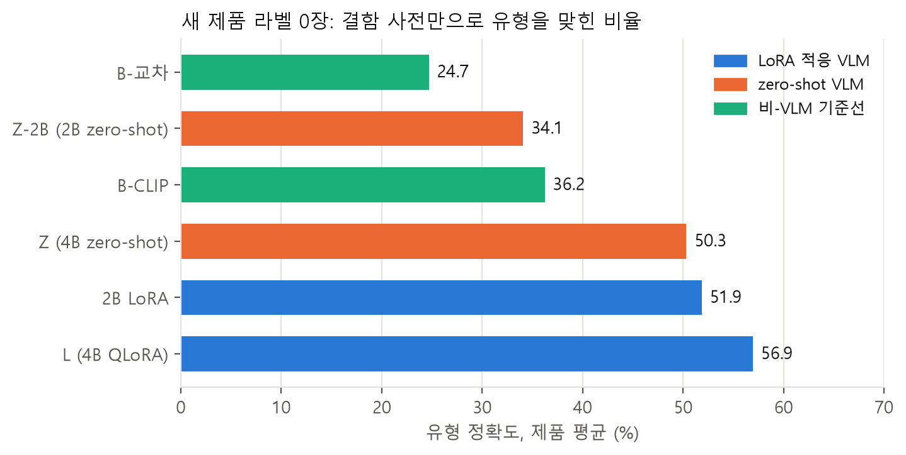
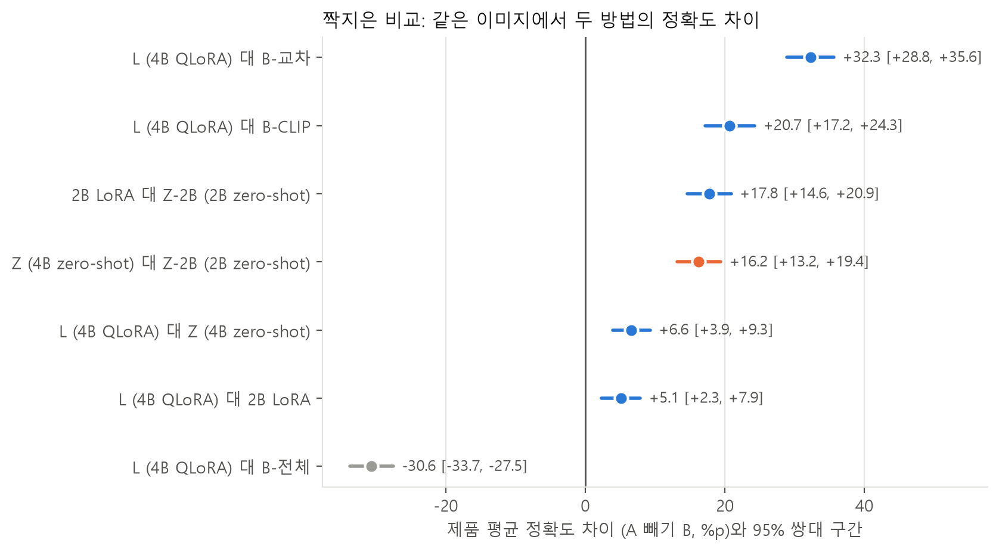
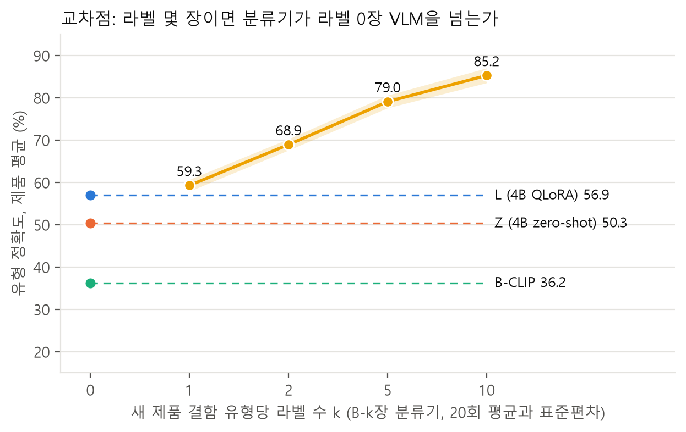
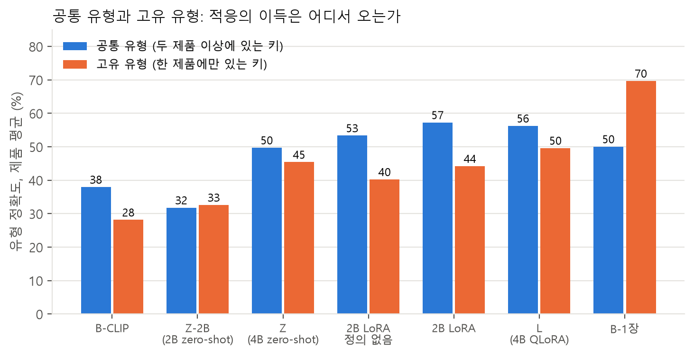
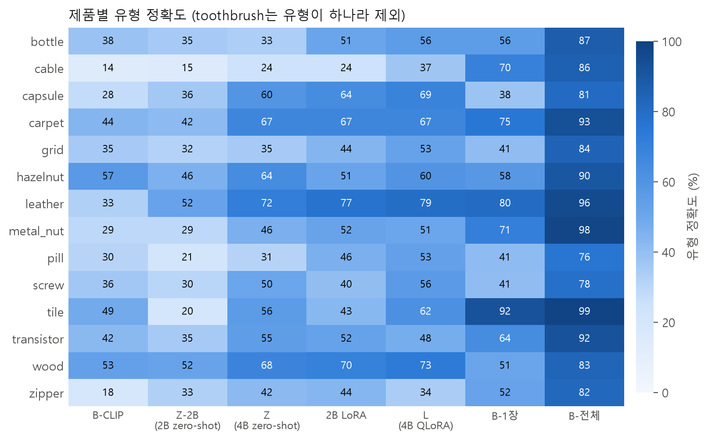

# 결과 보고

설계와 판정 기준은 [사전 등록 문서](preregistration.md)에 결과를 보기 전에 적었다. 이 문서는 그 기준으로 결과를 읽는다. 숫자는 모두 `reports/tables/summary.md`에서 가져왔고, 그림은 `python -m src.report.figures`로 다시 그릴 수 있다.

## 1. 한눈에 보기

새 제품의 결함 라벨이 0장일 때, 결함 사전만 읽은 4B QLoRA 모델(L)은 결함 유형을 제품 평균 56.9% 맞혔다. 라벨 0장 비-VLM 기준선의 최고치 36.2%보다 20.7점 높고, 95% 쌍대 구간 [17.2, 24.3]은 0을 제외한다. 그러나 새 제품 결함 유형당 라벨 1장으로 학습한 분류기가 59.3%로 이미 L을 넘는다. VLM의 이득은 라벨이 한 장도 없는 구간에만 있다.



적응의 이득은 두 곳에서 온다. 하나는 다른 제품에서 배운 공통 결함 어휘의 전이이고, 다른 하나는 "결함 없음"을 말하는 법이다. 고유 유형에서의 이득은 작고 구간이 0을 걸친다. 정의 문장을 빼면 정확도가 떨어지지만 그 효과는 고유 유형에 집중되지 않아, 모델이 정의를 읽고 새 유형을 추론한다는 가설은 지지되지 않았다.

## 2. 무엇을 돌렸는가

MVTec AD 15개 제품을 제품 단위 5-fold로 나누었다. 각 fold에서 12개 제품의 결함 이미지로 LoRA를 학습하고, 남은 3개 제품은 결함 사전(유형 이름과 한 줄 정의)만 주고 평가했다. 지표는 결함 이미지의 유형 정확도를 제품별로 구해 평균한 값이다(유형이 하나뿐인 toothbrush 제외, 14개 제품). 신뢰구간은 같은 이미지에 낸 정오를 짝지은 제품 층화 부트스트랩 10,000회의 95% 구간이고, 유의성은 McNemar 정확 검정에 Holm 보정을 더했다.

| 기호 | 방법 | 새 제품 라벨 |
|---|---|---|
| L | Qwen3-VL-4B QLoRA(NF4), 12개 제품으로 적응, 입력은 검사 이미지와 이상 영역 crop과 사전 | 0 |
| Z | 같은 입력의 Qwen3-VL-4B zero-shot(NF4) | 0 |
| Z-2B | 같은 입력의 Qwen3-VL-2B zero-shot(bf16) | 0 |
| 2B LoRA | Qwen3-VL-2B LoRA(bf16), 입력 구성 선별에 쓴 모델 | 0 |
| 2B 정의 없음 | 2B LoRA와 같으나 사전에서 정의 문장을 뺀 변형 | 0 |
| B-교차 | 12개 제품의 결함으로 공통 키를 분류하는 로지스틱 회귀(DINOv2 특징과 이상 맵 통계) | 0 |
| B-CLIP | SigLIP 이미지 임베딩과 "제품 + 정의" 텍스트 임베딩의 유사도로 유형 선택 | 0 |
| B-k장 | 유형당 k장으로 학습한 로지스틱 회귀(DINOv2 특징), 추출 20회 반복 | 유형당 k |
| B-전체 | 새 제품 라벨 전부로 5-fold 교차 검증한 로지스틱 회귀 | 전부 |

L의 입력 구성은 2B의 네 구성 중 평가 정확도가 가장 높은 "정상 참조 없음"을 사전 등록의 선별 기준대로 골랐다. 정의 문장의 효과는 예산 때문에 4B 대신 2B로 쟀다(변경 기록 2026-11-02).

## 3. 라벨 0장: VLM 대 비-VLM

| 방법 | 유형 정확도(제품 평균) | 이미지 평균 | 공통 유형 | 고유 유형 | macro-F1 | 정상 판정률 | 형식 준수율 |
|---|---|---|---|---|---|---|---|
| B-교차 | 24.7 | 23.3 | 54.2 | 0.0 | 13.6 | | 85.0 |
| B-CLIP | 36.2 | 34.3 | 37.9 | 28.1 | 27.3 | | 100.0 |
| Z-2B | 34.1 | 32.9 | 31.8 | 32.6 | 28.6 | 35.5 | 100.0 |
| Z | 50.3 | 49.3 | 49.7 | 45.4 | 45.0 | 27.8 | 99.9 |
| 2B LoRA | 51.9 | 51.1 | 57.2 | 44.2 | 47.5 | 59.1 | 100.0 |
| 2B 정의 없음 | 45.7 | 45.4 | 53.3 | 40.2 | 41.8 | 69.0 | 99.8 |
| L | 56.9 | 56.4 | 56.2 | 49.6 | 53.9 | 72.6 | 100.0 |

B-교차는 고유 유형을 원리상 맞힐 수 없어 0이다. B-CLIP은 정의 문장을 읽는 비-VLM 방법인데 고유 유형 28.1에 그친다. L은 고유 유형을 49.6 맞혀, 글로 적힌 새 유형을 이미지에 대응시키는 능력은 VLM 쪽에만 있다.

짝지은 비교는 아래와 같다. 차이는 A에서 B를 뺀 제품 평균 정확도이고, 괄호는 95% 쌍대 구간이다. 여덟 비교 모두 Holm 보정 후 p<0.001이다.



| 비교(A 대 B) | A | B | 차이 | 95% 구간 |
|---|---|---|---|---|
| L 대 B-교차 | 56.9 | 24.7 | +32.3 | [+28.8, +35.6] |
| L 대 B-CLIP | 56.9 | 36.2 | +20.7 | [+17.2, +24.3] |
| L 대 Z | 56.9 | 50.3 | +6.6 | [+3.9, +9.3] |
| L 대 2B LoRA | 56.9 | 51.9 | +5.1 | [+2.3, +7.9] |
| 2B LoRA 대 Z-2B | 51.9 | 34.1 | +17.8 | [+14.6, +20.9] |
| Z 대 Z-2B | 50.3 | 34.1 | +16.2 | [+13.2, +19.4] |
| 2B LoRA 대 2B 정의 없음 | 51.6 | 45.7 | +5.9 | [+3.5, +8.3] |
| L 대 B-전체 | 56.9 | 87.6 | -30.6 | [-33.7, -27.5] |

2B LoRA 대 2B 정의 없음은 같은 전체 입력(정상 참조 포함) 끼리의 비교다.

## 4. 교차점: 라벨 몇 장이면 분류기가 따라잡는가



| 유형당 라벨 k | B-k장 정확도(20회 평균) | 표준편차 |
|---|---|---|
| 1 | 59.3 | 1.4 |
| 2 | 68.9 | 1.3 |
| 5 | 79.0 | 1.5 |
| 10 | 85.2 | 1.7 |

k가 1일 때 분류기가 이미 L의 56.9를 넘는다. 교차점 k는 1이다. B-k장은 뽑은 이미지를 평가에서 빼므로 채점 집합이 VLM과 조금 다르지만, 두 값의 차이는 그 영향으로 뒤집힐 폭이 아니다. 라벨 두 장이면 12점 차로 벌어진다.

## 5. 적응의 이득은 어디서 오는가



| 비교(A 대 B) | 범위 | A | B | 차이 | 95% 구간 |
|---|---|---|---|---|---|
| L 대 Z | 공통 유형 | 56.2 | 49.7 | +6.5 | [+3.6, +9.5] |
| L 대 Z | 고유 유형 | 49.6 | 45.4 | +4.2 | [-0.3, +8.7] |
| L 대 Z | 정상 판정률 | 76.9 | 24.8 | +52.1 | [+48.0, +56.0] |
| 2B LoRA 대 Z-2B | 공통 유형 | 57.2 | 31.8 | +25.5 | [+21.0, +30.1] |
| 2B LoRA 대 Z-2B | 고유 유형 | 44.2 | 32.6 | +11.6 | [+7.5, +15.8] |
| 2B LoRA 대 Z-2B | 정상 판정률 | 66.5 | 38.5 | +27.9 | [+24.2, +31.7] |
| L 대 2B LoRA | 공통 유형 | 56.2 | 57.2 | -1.0 | [-5.3, +3.3] |
| L 대 2B LoRA | 고유 유형 | 49.6 | 44.2 | +5.4 | [+0.6, +10.4] |

정상 판정률의 A와 B는 제품 평균이라 3절의 이미지 평균과 조금 다르다.

세 가지가 읽힌다.

- 적응은 공통 유형에서 확실히 이득을 준다. 다른 제품에서 본 "균열", "긁힘", "이물 혼입" 같은 어휘가 새 제품으로 옮겨 간다.
- 고유 유형의 이득은 4B에서 4.2점이고 구간이 0을 걸친다. 글로만 주어진 새 유형을 맞히는 능력은 적응보다 기저 모델의 몫이 크다.
- 적응은 "결함 없음"을 말하는 법을 가르친다. zero-shot 4B는 정상 이미지의 4분의 1만 정상이라 답하고 나머지는 사전의 어느 유형이든 골라 버린다. 적응 뒤에는 4분의 3을 정상이라 답한다.

모델 크기와 적응을 분리하면, 2B에서 4B로 가는 이득(zero-shot 16.2점)과 2B를 적응하는 이득(17.8점)이 맞먹는다. 적응한 2B는 적응하지 않은 4B와 같은 수준이다. 4B를 적응하면 2B LoRA보다 5.1점 더 오르는데, 그 차이는 고유 유형에서 난다.

## 6. 정의 문장을 읽는가

사전에서 정의 문장을 빼고 이름만 주면 2B LoRA의 제품 평균이 5.9점 떨어진다. 사전 등록의 판정 기준은 "고유 유형이 10점 이상 떨어지고 구간이 0을 제외하되, 공통 유형에서는 구간이 0을 포함"이었다. 결과는 반대 방향에 가깝다. 고유 유형 하락은 2.8점으로 구간 [-0.3, +6.1]이 0을 포함하고, 공통 유형 하락 4.5점의 구간 [+1.0, +8.0]은 0을 제외한다. 정의 문장은 도움이 되지만, 새 유형을 정의에서 추론하는 식이 아니라 이미 아는 유형의 이름을 고르는 데 보태는 식이다. 이 판정은 4B가 아닌 2B 기준이라는 한계가 있다.

## 7. 라벨이 충분하면

새 제품 라벨 전부로 교차 검증한 로지스틱 회귀(B-전체)는 87.6으로 L보다 30.6점 높다. 예상한 대로 라벨이 모이면 전문 분류기가 낫다. VLM이 전체 라벨 분류기를 이기는 결과는 없었다.

## 8. 제품별 결과



fold별 제품 평균으로 보면 L이 Z를 넘은 fold는 다섯 중 넷이다. transistor, wood, zipper가 든 다섯째 fold에서는 L이 51.5, Z가 55.1로 적응이 오히려 낮았다. zipper에서 적응 뒤 틀리게 바뀐 이미지가 23장으로 맞게 바뀐 13장보다 많고, 그 대부분이 "안쪽 천 손상"을 "복합 결함"으로 답한 경우다. cable은 모든 라벨 0장 방법이 37 이하로 가장 어렵다. 결함이 여덟 유형이고 "자리 바뀜", "누락" 같은 유형은 정상 배선을 알아야 보이기 때문이다.

## 9. 실패 사례

자세한 표는 `reports/tables/failures.md`에 있다. 요약하면 다음과 같다.

- 가장 흔한 실패는 결함을 정상으로 답하는 놓침이다. metal_nut의 "뒤집힘"은 23장 중 19장을 정상이라 답했다. 뒤집힌 너트는 모양이 멀쩡해서 "무엇이 잘못됐는가"를 한 문장으로 적은 정의만으로는 잡히지 않는다. cable의 "자리 바뀜"도 같은 이유로 12장 중 10장을 놓쳤다.
- 뜻이 가까운 공통 유형끼리 섞인다. hazelnut의 "베임"을 "균열"로, carpet의 "베임"과 "구멍"을 "실 풀림"으로 답한다. 정의가 서로 비슷한 유형일수록 섞이고, 이 경우 라벨 한두 장이 바로 해결한다.
- 오경보는 제품에 집중된다. transistor는 정상 60장을 전부 결함이라 답했고 hazelnut은 40장 중 24장이다. 반면 cable과 zipper는 오경보가 거의 없다. 정상 판정의 기준이 제품마다 다르게 잡힌 것으로, 정상 참조 이미지를 뺀 입력 구성의 비용으로 보인다.
- 적응 모델의 근거 문장은 예측한 유형의 사전 정의를 글자 그대로 되뇐다(1,268장 전부). 학습 표본의 근거를 정의 문장으로 만들었기 때문이며, 설계대로다. 근거 줄은 이미지를 서술하지 않으므로 설명으로 읽어서는 안 된다. zero-shot 모델은 1,153가지 서로 다른 문장을 썼다.

## 10. 가설 판정

| 가설 | 기준 | 결과 | 판정 |
|---|---|---|---|
| H1 라벨 0장에서 L이 비-VLM보다 낫다 | 10점 이상 높고 구간이 0 제외 | +20.7 [+17.2, +24.3] | 지지 |
| H2 교차점 k가 3 이상 | k=1, 2에서 L이 높음 | k=1에서 분류기 59.3이 L 56.9를 넘음 | 기각 |
| H3 정의 문장을 읽는다 | 고유 유형 10점 이상 하락, 공통은 구간이 0 포함 | 고유 -2.8 [-6.1, +0.3], 공통 -4.5 [-8.0, -1.0] | 기각(2B 기준) |
| H4 라벨이 충분하면 분류기가 낫다 | B-전체가 L 이상 | 87.6 대 56.9 | 지지 |
| H5 적응은 형식과 정상 판정을 배운다 | 형식 95% 이상, 정상 판정률이 Z보다 높고 구간이 0 제외 | 형식 100, 정상 판정 +52.1 [+48.0, +56.0] | 지지 |

사전 등록의 결과별 해석 표에 따르면 "H1 지지, H2 기각"은 이렇게 읽는다. 이득은 있으나 라벨 한두 장이면 사라진다. 사전만으로 시작할 수 있다는 점이 남는 가치다. "H3 기각"은 모델이 유형 이름과 시각 사전 지식으로 답하며 정의 문장은 이 과제에서 추론의 재료로 읽히지 않았다는 뜻이다.

## 11. 사전학습 노출 탐침

사전 없이 "이 이미지의 결함을 한 단어로 말하라"고 물었을 때 4B 모델이 폴더 이름(영어)을 그대로 맞힌 비율은 6.4%다. wood와 hazelnut이 20~30%로 높은데 "hole", "crack"처럼 일반 명사인 유형이다. 데이터셋을 외운 흔적으로 보기는 어렵다.

## 12. 학습 운영 실측

RTX 3060 12GB 한 장에서 돌렸다. 대기열 47개 작업이 실패와 재시도 없이 끝났다.

| 항목 | 2B LoRA(bf16) | 4B QLoRA(NF4) |
|---|---|---|
| fold당 학습 시간 | 60~92분 | 2시간 22~34분 |
| 학습 표본당 시간 | 0.9~1.5초 | 2.1초 |
| 최대 VRAM(학습) | 5.1GB | 5.3GB |
| 최대 VRAM(생성) | 7.3GB(배치 8) | 6.3GB(배치 4) |
| 생성 속도 | 장당 1.0초 | 장당 2.1초 |

학습 설정은 LoRA rank 16, alpha 32, 학습률 1e-4, epoch 3, batch 1에 누적 8, gradient checkpointing, 이미지 512 픽셀이다. 2단계(2B 네 구성 20 run과 zero-shot)는 25.5시간, 3단계(4B 5 fold와 zero-shot, 정의 없음 변형)는 20.3시간이 걸렸다.

## 13. 한계

- 제품이 15개라 fold 간 분산이 크다. 다섯째 fold처럼 적응이 해가 되는 경우가 있고, 제품을 바꾸면 수치가 달라질 수 있다.
- 공통/고유 구분은 키 일치라서 "scratch"와 "scratch_head"처럼 뜻이 비슷한 쌍을 고유로 센다. 공통 유형의 전이 효과가 과소평가됐을 수 있다.
- 정의 문장 효과는 2B로 쟀다. 4B에서 다른 결과가 나올 가능성을 배제하지 못한다.
- 결함 사전은 한 사람이 썼다. "뒤집힘"처럼 정의로 잡히지 않는 유형은 문장을 달리 쓰면 결과가 바뀔 수 있다.
- 근거 줄은 정의 문장의 복사이므로 설명 능력에 대해서는 아무것도 말하지 않는다.
- B-k장은 뽑은 이미지를 평가에서 빼므로 VLM과 채점 집합이 조금 다르다.

## 14. 다시 만들기

```
python -m src.report.aggregate --vlm z4b="runs/z4b/f*_predictions.jsonl" --vlm z4b_noref="runs/z4b_noref/f*_predictions.jsonl" --vlm z2b="runs/z2b/f*_predictions.jsonl" --vlm 2b_full="runs/2b_full/f*/eval_predictions.jsonl" --vlm 2b_nocrop="runs/2b_nocrop/f*/eval_predictions.jsonl" --vlm 2b_noref="runs/2b_noref/f*/eval_predictions.jsonl" --vlm 2b_img="runs/2b_img/f*/eval_predictions.jsonl" --vlm 2b_nodef="runs/2b_nodef/f*/eval_predictions.jsonl" --vlm l4b="runs/l4b/f*/eval_predictions.jsonl" --pair l4b:b_clip --pair l4b:b_cross --pair l4b:z4b_noref --pair l4b:b_full --pair 2b_full:2b_nodef --pair l4b:2b_noref --pair 2b_noref:z2b --pair z4b_noref:z2b --pair-scope l4b:z4b_noref --pair-scope 2b_full:2b_nodef --pair-scope 2b_noref:z2b --pair-scope l4b:2b_noref
python -m src.report.figures
python -m src.report.failures --main l4b="runs/l4b/f*/eval_predictions.jsonl" --ref z4b_noref="runs/z4b_noref/f*_predictions.jsonl"
```

예측 원본(`runs/`)은 용량 때문에 저장소에 없다. 표와 그림의 입력인 `reports/tables/summary.json`과 비-VLM 예측(`reports/predictions/`)은 저장소에 있다.
